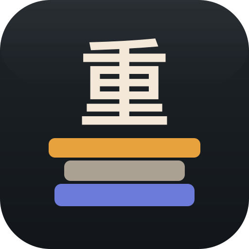
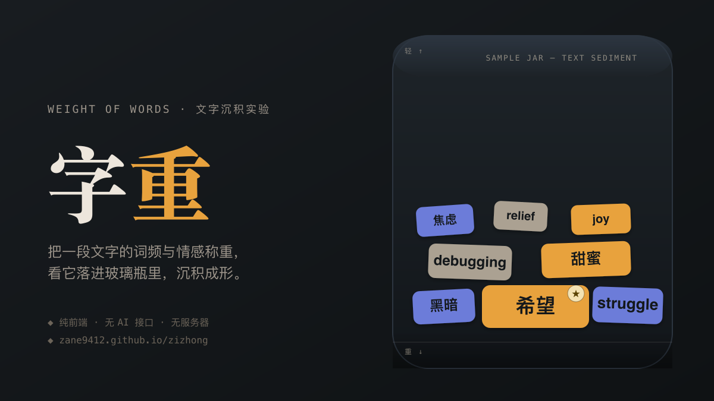

# 字重 (zizhong)



把一段文字的词频与情感，可视化成落进玻璃样本瓶里的矿物沉积。纯前端单页应用，不调用任何 AI 接口，不依赖服务器。

在线体验：https://zane9412.github.io/zane-zizhong/



## 这是什么

粘贴一段中文/英文文字，每个词会按「出现频次 + 情感强度」被称重，投进一只样本瓶——越重的词沉得越深，越轻的飘在最上层，颜色区分暖（积极）/ 冷（消极）/ 灰（中性）。可以拖动词块、一把吹散重新沉淀、保存成图片、或复制一条带着你的文字的分享链接。

## 技术实现

- **分词**：浏览器原生 `Intl.Segmenter` 做中英文混合分词，不依赖任何外部分词库或接口
- **情感判断**：内置一份手工整理的中英文情感词典（约 150 词，评分 -2 到 +2），全部跑在本地
- **堆叠物理**：自研的「skyline 打包」算法——先把整批词一次性排布好落点（谁落在哪一列、落多深），再让它们按顺序真正下落，避免了「好几个词同时抢同一个位置」的问题
- **零依赖**：没有引入任何前端框架或物理引擎，全部是原生 Canvas 2D + requestAnimationFrame

## 项目结构

```
index.html        页面骨架
styles.css        样式
src/analyze.js    纯逻辑：分词、情感词典、重量计算、配色映射（不碰 DOM，可单测）
src/app.js        Canvas 渲染、下落堆叠模拟、交互与 DOM 绑定
test/             针对 src/analyze.js 的单元测试（Node 内置测试跑器，零依赖）
```

## 创作背景

为参加掘金"Vibe 作品广场"首发挑战而做。故意避开了 regex 可视化、日志时间线、JSON diff 这些已经很常见的数据可视化套路，想找一个更少见的角度——让文字本身的"分量"变成可以摸得到、可以互动的物理对象。全程和 Claude Code 协作完成，堆叠算法推翻重写过两次（第一版随机选位置导致好几个词叠在一起看不见），也是这次"边试边改"最有意思的部分。

## 本地运行

直接用浏览器打开 `index.html` 即可，或起一个静态服务器（`type="module"` 的脚本在部分浏览器下需要 http(s) 协议，双击打开本地文件可能没反应）：

```bash
npx serve .
```

## 测试

```bash
npm test
```
